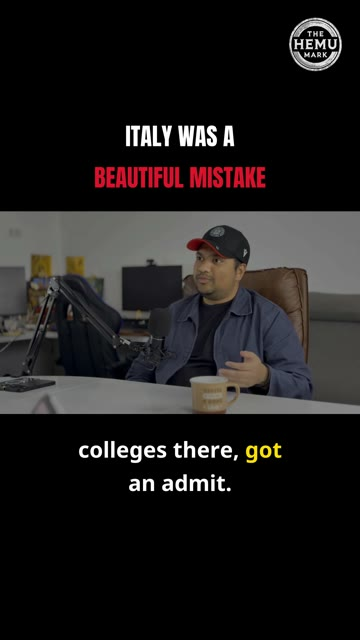
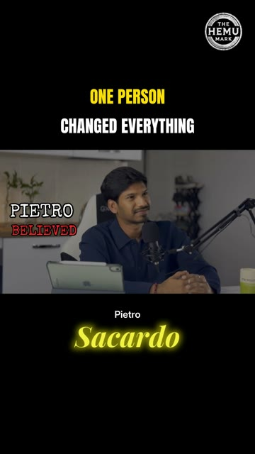
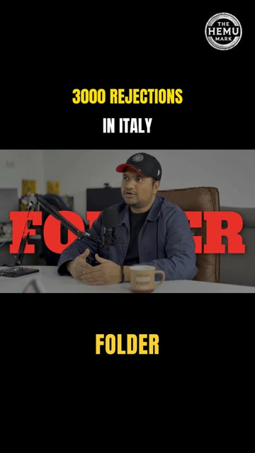
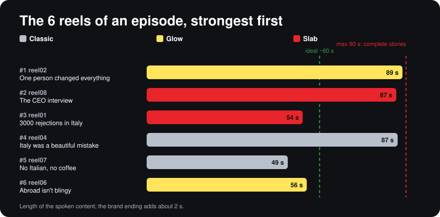
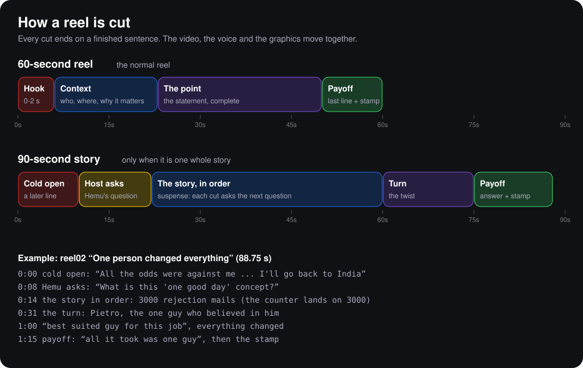

# HemuReelCreations (HRC) v0.9

Turns a finished Telugu episode of **The Hemu Mark Reality Check** into the **6 strongest reels** of the
episode (9:16, 1080x1920, 30 fps). The ideal reel is about **60 seconds**; a reel may run to **90 seconds**
only when it tells a complete story, cut like a suspense trailer around the host's questions. Every reel
gets **English captions** (the speech stays Telugu), graphics that land on the exact frame of the word and
sit **behind you** (the cut-out keeps you, the mic and the table in front), and one of **three text looks**.
Every reel also comes with a **layered DaVinci Resolve project** (every graphic, caption, logo and sound on its
own track) so you can restyle it to your taste.


---

## The three text looks (2 reels each)

Claude gives every reel a `"look"` in `reels_plan.json` and spreads them evenly. Same layout, same graphic
timing; only the fonts and colours of the captions and big words change.

| Classic | Glow | Slab |
|---|---|---|
|  |  |  |
| The first landscape version: white Noto Sans caption lines, the word being spoken lights up yellow, key words red; stacked Anton words on the picture | The previous version: small white words as they are spoken, the key word big in a glowing yellow italic serif | The present version: one huge red slab word behind you; captions one or two words at a time, big, in colour |

To change a reel's look, edit `"look": "classic" | "glow" | "slab"` on that reel in `reels_plan.json`, then
`hrc render --reel <reel>` (about 2 minutes: the cut-out is reused). The settings of each look are
in `src/hrc/looks.py`; override any of them in `config.yaml` under `looks.<name>`.

---

## Which reels: 6 per episode, strongest first



- Claude reads the whole episode, **ranks** every possible reel and keeps only the best 6 (`reel.count_min/max`).
- **About 60 s** is the normal reel: a hook in the first 2 seconds, context, payoff.
- **Up to 90 s** only for a complete story. It opens cold on the most gripping line; then the host's questions
  (the host is the one without the hat) carry it, every answer raising the next question, until the payoff:



---

## The whole process on one page


| # | Who | What you type (in Terminal) | What happens | How long |
|---|---|---|---|---|
| 0 | You | `cd ~/HemuReelCreations && source .venv/bin/activate` | Opens the HRC workspace. **Do this every time you open a new Terminal.** | 1 s |
| 1 | You | edit `config.yaml` → `input.video`, `input.srt` | Tells HRC which episode to use | 1 min |
| 2 | Mac | `hrc ingest` | Reads the subtitles, finds camera changes and faces | 5–10 min |
| 3 | Mac | `hrc align` | Finds the exact time of every spoken word | ~10 min |
| 3b | Mac | `hrc realign` | Second pass: squashed words are re-timed from the sound itself, and the start of every sound is saved so graphics land on the exact frame | 1–2 min |
| 4 | Mac | `hrc select prepare` | Writes the transcript and the brief into `cache/select/` | 10 s |
| 5 | Claude | (in the project chat) | Claude ranks the reels and writes `reels_plan.json` for the best 6: cuts, headline, graphics, sounds, `rank` and `look` | — |
| 6 | You | `hrc select check` then `hrc approve` | Checks lengths and snaps cuts between words. **Nothing renders before you approve.** | 10 s |
| 7 | Mac + Claude | `hrc translate prepare` → Claude fills the English → `hrc translate build` | English caption files in `subs/`. Mark the key word of a line with stars: `in my *résumé*`. `build` alone re-times existing translations (never overwrites them) | — |
| 8 | Mac | `hrc assets` | Downloads 5 HD photos (2400 px+, licences that allow monetised use) per photo moment and draws a numbered sheet per reel in `assets/sheets/` | 2–4 min |
| 8b | You or Claude | look at `assets/sheets/reelNN.jpg` | Not the best photo? Add `"pick": 3` to that moment in `reels_plan.json`, run `hrc assets` again (instant) | 1 min |
| 9 | You | `hrc render --reel reel01,reel02` | **Two reels at a time.** Cuts you out where a graphic sits behind you, renders each reel in its look and builds its Resolve pack. Watch the pair, then ask for the next two | 10–14 min per reel the first time, ~2 min after that |
| 10 | Mac | `hrc qa --reel reel01,reel02` | Checks length, loudness, captions, faces → `qa_report.md` | 1 min |
| 11 | You | DaVinci Resolve | Import the layered timeline, restyle, export (see below) | your call |

Work on some reels only: add `--reel reel02,reel05`. Redo a step from scratch: add `--force`.
Every step writes plain files you can open and edit; running a step again skips work whose inputs
didn't change.

**Two reels at a time.** For this episode the pairs are `reel01,reel02`, then `reel04,reel08`, then
`reel06,reel07`. Run a long render in the background like this, so Telugu letters still draw correctly
(plain `nohup hrc ...` loses the text-shaping library):

```bash
bash -c 'cd ~/HemuReelCreations && source .venv/bin/activate && hrc render --reel reel04,reel08' > render.log 2>&1 &
```

### First-time setup (once per Mac)

```bash
cd ~/HemuReelCreations
bash setup_mac.sh            # ffmpeg, Python packages, fonts check, then `hrc doctor`
source .venv/bin/activate
hrc doctor                   # every line should say OK
```

Music: put royalty-free tracks in `assets/music/<mood>/` (moods: inspirational, tense, emotional,
funny, calm, energetic). **Without music the reels render with speech and sound effects only** (that is the
case today: the folder is empty). Your own sound effects go in `assets/sfx/<kind>/` and replace HRC's built-in ones.

---

## What you get

```
qa_report.md                         checks for every file (in the HRC folder)
output/
  reel02/
    reel02_en.mp4                    ready to post
    reel02_clean.mp4                 no captions
    reel02_mix.wav                   the finished sound
    resolve_en/                      the layered Resolve project (see below)
      reel02_en.fcpxml               import this into Resolve
      EDIT_SHEET.md                  every track and clip with its time, text and sound
      media/                         video, graphics, cut-outs, captions, logo, audio
```

A small phone copy (`reel02_en_phone.mp4`, about 3 MB) is made when `export.phone_preview: true`.

---

## Polishing a reel in DaVinci Resolve


**Import**

1. Open DaVinci Resolve and create or open a project. Set the project to 1080x1920, 30 fps:
   *File → Project Settings → Master Settings → Timeline resolution: 1080 x 1920 (custom), 30 fps*.
2. *File → Import → Timeline…* and pick `output/<reel>/resolve_en/<reel>_en.fcpxml`.
3. When Resolve asks, leave **"Automatically import source clips into media pool"** ticked.
   All media is in the `media/` folder next to the .fcpxml, so nothing goes offline.
4. Open `EDIT_SHEET.md` in the same folder. It lists every track and clip with its time, text,
   animation and sound.

**What is on each track**

| Track | Contents | Things you can do |
|---|---|---|
| V1 | Podcast video, cut at every join; the ending stamp after it | Trim, reorder, put a Resolve transition on any edit point (markers name the suggested one), colour grade |
| V2 | Photo backgrounds, rendered with the look from `config.yaml` (`gfx.backdrop`), slow push-in and fades | Grade it on the Color page, change opacity, retime, delete |
| V3 | The same photo as an untouched HD still (twice the timeline size), **off** | Select it, press **D**, turn V2 off: now zoom, reframe and grade the full-quality photo yourself. The original download is in `media/photos/` |
| V4 | Each graphic alone, with transparency (`gfx/gNN.mov`): words, counters, pictures | Move, scale, retime, fade, change opacity, delete or replace it |
| V5 | You cut out, **plus the mic, cups, bottles and other things in front of you**, only while a graphic is behind you | Delete one to bring that graphic in front of you |
| V6 | Graphic parts that sit in front of you (counters) | Same as V4 |
| V7 | Corner logo (the white stamp) | Move, resize, change opacity, turn off |
| V8 | Headline above the video, as a picture | Turn off (select it, press **D**) when you use V9 instead |
| V9 | Headline as Resolve text, **off** by default | Select it, press **D** to turn it on, then change words, font, size and colour in the Inspector |
| V10 | Captions in the reel's look, with transparency | Move or turn off. For captions you style yourself: *File → Import → Subtitle…* and pick `media/captions_en.srt` |
| V11 and up | The words of every graphic as Resolve text, **off** by default | To restyle a graphic yourself: turn its V4 clip off, turn this one on (**D**), then set words, font, colour and size in the Inspector and add any title animation from the Effects library (Fusion titles, Text+ "Write On" for a typewriter) |
| A1 | Speech (cleaned) | Level, EQ, noise reduction |
| A2 | Music, already ducked under the speech | Level, swap the song |
| A3 and up | One clip per sound effect, gain already set | Move, change volume, delete, or drag in your own sound |

**Changing fonts and colours of the baked layers** (captions, graphics text, headline picture):
edit `config.yaml` (fonts under `subtitles.fonts`, colours under `project.brand_colors`, headline
size under `layout.reel`), then rebuild just that pack in about a minute:

```bash
hrc resolve --reel reel02 --lang en       # or --lang en,te for several languages
```

Re-import the new .fcpxml (Resolve keeps your old timeline, so you can compare).

**Levels:** the separate tracks are not loudness-matched like the finished `.mp4`. When you're done,
select all audio clips and use *Normalize Audio Levels* (−14 LUFS for Instagram and YouTube), or
put a limiter on the main bus.

**Export:** *Deliver → Custom*, H.264 or H.265, 1080x1920, 30 fps, 12–16 Mbit/s, AAC 320 kbit/s.

By default the Resolve pack is built in English only (about 0.5–1 GB per reel). Add languages in
`config.yaml` → `export.resolve_langs`, or for one reel: `hrc resolve --reel reel02 --lang en`.

---

## Photos: ultra-HD and the right picture

- `hrc assets` only keeps photos at least **2400 px wide** (`assets.min_width`) whose licence allows monetised,
  edited use (CC0, public domain, CC BY, CC BY-SA, Pexels, Pixabay). Non-commercial (NC) and no-derivatives (ND)
  photos are skipped.
- For each photo moment it keeps **5 candidates** and draws `assets/sheets/<reel>.jpg`: numbered thumbnails with
  size and licence, the chosen one framed in green.
- To use another one, add `"pick": 3` (the number on the sheet) to that visual moment in `reels_plan.json` and run
  `hrc assets` again. To use your own photo, save it as `assets/images/<reel>/<moment number>.jpg`; it always wins.
- Free API keys give the best photos: put `PEXELS_API_KEY` and `PIXABAY_API_KEY` in your shell profile.
- The look behind you is set in `config.yaml` → `gfx.backdrop` (blur 0 = crisp; dim, desaturate, vignette, tint,
  push_in). In Resolve you can also grade the photo on V2 or use the untouched HD still on V3.

## The cut-out (you in front of the graphics)

Since v0.8 the cut-out is made **only on the frames where a graphic sits behind you** (plus 0.3 s on each side,
`matte.handle_sec`), so all the effort goes where it shows. On those frames a second model (BiRefNet,
`matte.edge_model`) redraws the edges at high resolution: single hairs, fingers, the thin mic arm. It only works in
a narrow band around the first cut-out, so it can sharpen an edge but never add the wall or drop your arm.
Faster model: `ZhengPeng7/BiRefNet_lite`. Off: `matte.edge_refine_model: false`. Cut out every frame again:
`matte.only_where_needed: false`.

A depth model (Depth Anything V2) measures how far every pixel is from the camera. Everything nearer than you,
below your eye line, joins the cut-out: the mic and its arm, the mug, a laptop, the tabletop. Your chair and the
wall stay behind (`matte.depth_tolerance: -0.03`; higher keeps more, lower keeps less). Apple Vision's object
finder adds anything it detects. Objects are steadied over 5 frames so they never flicker, and every edge is
cleaned against the picture (`matte.refine_edges`). Turn it off with `matte.depth_objects: false`.

**Where the graphics sit (v0.9).** Big words, hero words and big counters sit **behind you at shoulder height**,
on wide shots and close-ups alike; the cut-out (you, the mic, the table) stays in front, like the v0.8.2 reels.
Two switches in `config.yaml` change that:

| Setting | Default | When on |
|---|---|---|
| `gfx.close_up_front` | `false` | On close-up angles, hero words and big counters move in front of you, low over the chest, never over the face |
| `gfx.side_in_front` | `false` | On wide shots, a graphic beside your head is drawn in front of the mic arm, so the arm never crosses its letters |

If the mic arm covers a graphic's words in one reel, move that graphic on V4 in Resolve or delete its V5 cut-out clip.

## How the look is built (and the settings that control it)

| Element | What HRC does | Setting in `config.yaml` |
|---|---|---|
| Layout | The full 16:9 podcast in a box in the middle of the 9:16 frame; headline and logo above it, captions under it, nothing of them on the picture. `fullbleed: true` gives a full-screen close-up instead | `layout.reel.*` |
| Picture | Brightness lift only; no colour grade (contrast, saturation, warmth, vignette stay neutral) | `grade.exposure: 0.12` |
| Cuts | The cuts follow the conversation: only the master's own camera switches, no reaction cutaways | `reactions.enabled: false` |
| Graphic timing | Each graphic lands on the frame where its word's sound starts. Still off? Add `"nudge": 2` (frames later) or `-2` (earlier) to that moment | `gfx.snap_to_onset`, `"nudge"` |
| Tracking | Graphics are pinned to the room: when the framing pans or punches in, they move and grow with it | `gfx.track`, per moment `"track": false` |
| Framing | Steady "tripod" framing that follows the face slowly, punch-in zooms on emphasis words | `reframe.*` |
| Clean cuts | A camera angle never flashes on screen for less than 0.4 s; the crop changes on the exact frame | `reframe.min_shot_sec` |
| Cut-out | Apple Vision person + object segmentation (mic, cups, bottles stay in front), depth check, edge clean-up; RVM or MediaPipe as fallbacks | `matte.*` |
| Photos | HD photos (2400 px+), crisp by default, numbered candidate sheets | `assets.*`, `gfx.backdrop.*` |
| Graphics | Photo backgrounds, big counters (₹/$/€ count up, sized to fill the picture), hero words, stacked words with typewriter, glitch or fade; behind you at shoulder height | per moment in `reels_plan.json`, `gfx.*` |
| Cinematic pace | Words fade in and settle slowly (no glitch or snap), and every graphic stays up at least 2.8 s so it can be read | `gfx.cinematic`, `gfx.default_hold_sec` |
| Captions | One of three looks per reel (classic, glow, slab, see the top of this guide). Every word is timed to the speech; a line never overlaps the next, and a word on screen for less than 0.65 s joins the next one instead of flashing | `"look"` per reel, `looks.*`, `subtitles.punch.min_beat_sec` |
| Sound | Speech cleanup, ducked music, sound effects only on 2–4 key moments, −14 LUFS | `audio.*` |
| Brand | Your round stamp as the corner logo, and a stamp slam with sound at the end | `project.logo*`, `project.end_stamp_size` |

In `reels_plan.json` each visual moment can carry:
`"anim"` (typewriter, glitch, fade, zoom, slide; with `gfx.cinematic` on, glitch, pop and slide become a soft zoom), `"style"` (backdrop or sprite for pictures),
`"sfx": true` (make sure it gets a sound) or `"sfx": false` (keep it silent).
A reel can switch off its ending with `"outro": false`.

---

## When something goes wrong

| You see | Do this |
|---|---|
| `command not found: hrc` | Run `source .venv/bin/activate` inside `~/HemuReelCreations` first |
| "The reel plan is not approved yet" | Run `hrc select check` and `hrc approve` |
| "no hi subtitles yet" | Run `hrc translate build` (translations must be filled first) |
| A reel is over 90 s (or over 60 s without a complete story) | Trim a segment in `reels_plan.json`, then `hrc select check && hrc approve` |
| Captions overlap or a line flashes by | Run `hrc translate build --reel <reel>` again, then `hrc render --reel <reel>`. Don't run `prepare` again on a filled reel: lines whose Telugu changed come back empty |
| Captions still go by too fast | Raise `subtitles.punch.min_beat_sec` (for example 0.8), then `hrc render --reel <reel>` |
| You want another text look for a reel | Change `"look"` on that reel in `reels_plan.json`, then `hrc render --reel <reel>` |
| Resolve shows clips as offline | Keep `media/` next to the .fcpxml; or right-click the bin → *Relink Selected Clips* and pick `media/` |
| A graphic covers the face | Check that its V5 cut-out clip is on, or move the V4 clip; see `qa_report.md` |
| A graphic lands a little early or late | Add `"nudge": 2` (2 frames later) or `"nudge": -2` to that moment in `reels_plan.json`, then `hrc render --reel <reel>` |
| "No edge refinement model" | `pip install timm kornia einops` inside the venv (the model downloads once, ~900 MB) |
| Wrong or blurry photo | Open `assets/sheets/<reel>.jpg`, set `"pick": n` on that moment, `hrc assets`, then `hrc render --reel <reel>` |
| The cut-out misses an object or takes one too many | Raise or lower `matte.object_max_area`, or set `matte.depth: false`; `hrc render --reel <reel> --force` |
| Telugu letters look broken in graphics | `brew install libraqm`, then `pip install --force-reinstall pillow` |
| Telugu letters broken only when run with `nohup` | Run long jobs as `bash -c 'source .venv/bin/activate && hrc render'` in the background; plain `nohup hrc ...` loses the text-shaping library |
| No music | Add files to `assets/music/<mood>/` and render again |

## Limits

- English captions follow the speech (pauses skipped) but the words are English and the voice is Telugu, so each
  English word is placed by its share of the line, not by a matching spoken word.
- Auto graphics are clean templates, not hand-made motion design. Polish your best reels in Resolve.
- Web photos come from free sources (Openverse, Wikimedia). Anything flagged ⚠ in
  `assets/manifest.json` (logos, news, film stills, people) needs your call before posting.
- Hair edges can shimmer on fast movement; the matte flicker score is in `qa_report.md`.
- Words behind you on a tight close-up can lose a few letters behind your shoulders. If a word must read in full,
  turn on `gfx.close_up_front` (or move it on V4 in Resolve).

## Version history

- **v0.9** 6 ranked reels per episode (about 60 s; complete host-question stories up to 90 s, cold open first); three text looks, 2 reels each (classic, glow, slab); slow cinematic text (soft landings, 2.8 s minimum hold, no flashing words); captions re-timed so lines never overlap, also at cold-open joins; big count-up counters sized by their digits; graphics always behind the speaker (v0.8.2 look), with off-by-default switches for in-front placement; renders two reels at a time.
- **v0.8.2** The wide 16:9 shot boxed in the 9:16 frame with headline and logo above; one huge red slab word behind the speaker; one-word colour captions; no reaction cutaways; brightness-only picture.
- **v0.8** English-only, reference-reel look: full-screen close-up with a cinematic grade, small-white + big-serif captions, second word-timing pass and sound-onset landing for graphics, graphics pinned to the room, 1–2 s listener reaction shots, cut-out only where needed with BiRefNet edges, phone previews.
- **v0.8.1** Full-screen close-ups with no room above the head: big words, numbers and pictures move to the open side of the frame (tucking a little behind the head) so they stay readable.
- **v0.7.1** Depth-based object cut-out (mic arm, mug, tabletop), tuned on the real footage.
- **v0.7** Cut-out keeps the mic, cups and bottles in front; HD photos (2400 px+, commercial licences) with candidate sheets and `"pick"`; crisp, configurable photo look; photo and HD still on their own Resolve tracks; every graphic's words as editable Resolve text.
- **v0.6** Layered DaVinci Resolve pack (`hrc resolve`), illustrated README, 10 reels from HemuXSrinadh_Part1.
- **v0.5** Clean camera cuts, steady captions, sound only on key moments, brand stamp logo and ending stamp.
- **v0.4** Typewriter, glitch and fade text, money counters, softer cinematic sounds, Apple Vision cut-out, no opening text card.
- **v0.3** Reel layout: landscape video in a 9:16 frame with headline and captions, photo backgrounds behind the speaker.
- **v0.2** Steady framing, flicker-free 1–2 line captions, portrait and landscape formats.

---

To redraw the pictures in this guide: `python docs/tools/make_diagrams.py && python docs/tools/make_docs_svg.py && python docs/tools/make_tracks_svg.py`
(`make_docs_svg.py` reads `reels_plan.json`). To rebuild `README.html` (one file, pictures inside, opens with a
double-click): `python docs/tools/make_readme_html.py`.
